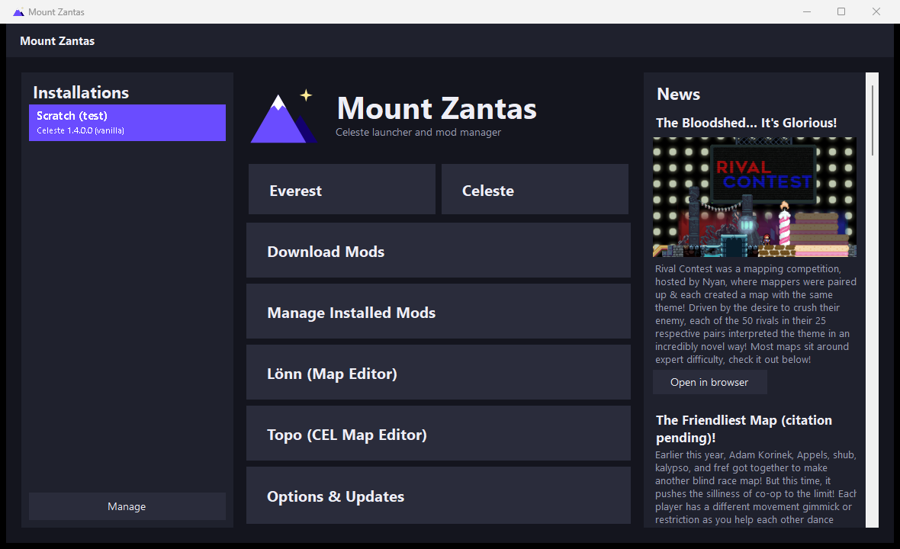
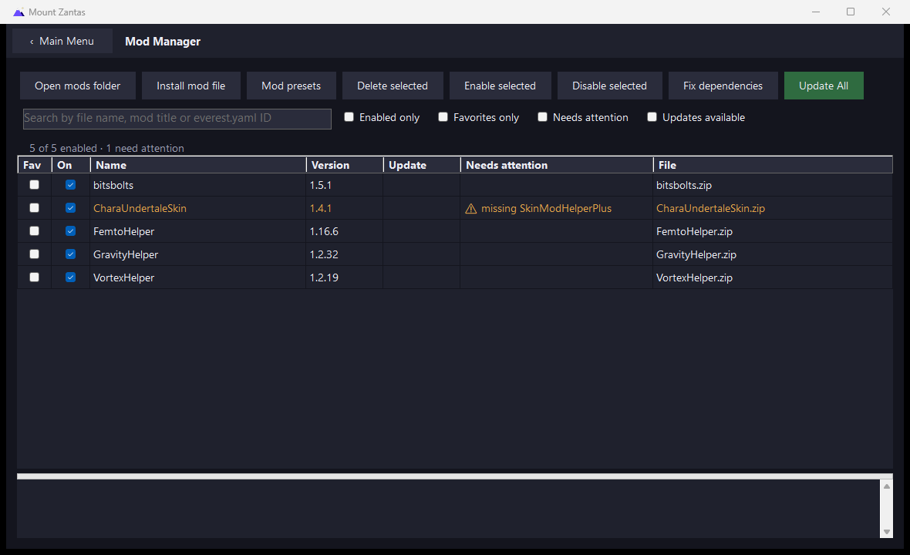
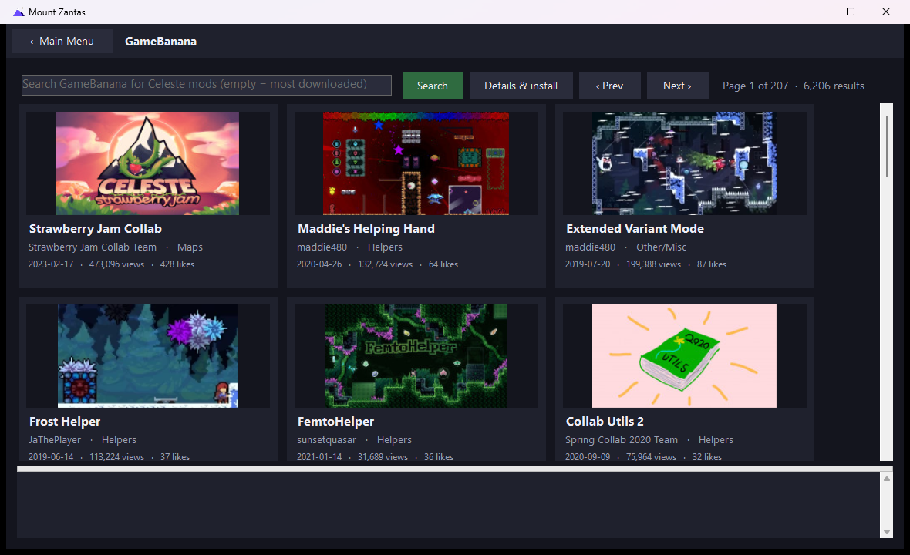
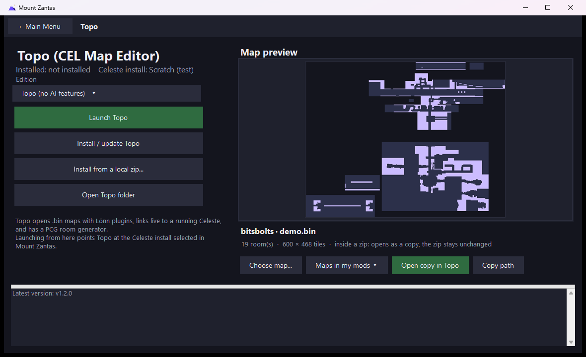

# Mount Zantas

A launcher and mod manager for [Celeste](https://www.celestegame.com/). It runs on top of the [Everest](https://github.com/EverestAPI/Everest) mod loader and puts the everyday jobs in one window: installing Everest, managing mods, browsing GameBanana, previewing maps, and opening them in a map editor.



## Features

- **Installations:** finds Celeste from Steam, Epic, GOG, the itch app, or any folder you pick.
- **Zantas Loader:** Mount Zantas's own loader layer, an Everest core mod installed together with Everest, so every Everest mod still works. It shows Zantas Loader on the title screen, reports back which mods loaded and which failed (Everest page > Load report), and lets you play a mod preset for one run without changing your mod list (Mod presets > Play with).
- **Everest:** install or remove any stable, beta or dev build. Downloads are checked against the SHA-256 GitHub publishes. Removing Everest restores your original game files.
- **Mod manager:** enable/disable mods, favorites, search and filters, presets, sort, bulk actions, update-all, delete to the Recycle Bin. It warns about missing or disabled required mods and can fix them in one click.
- **Download Mods:** search the public Everest mod database and install a mod with the helper mods it needs. Every download is checked against the database checksum.
- **GameBanana browser:** thumbnail cards, full descriptions with screenshots, and a version picker. Every file is checked against the MD5 GameBanana publishes.
- **News:** the community news feed (with pictures) and the latest Everest builds.
- **Map preview:** draws an overview of any Celeste `.bin` map, including maps inside mod zips. "Open copy in Topo / Lönn" extracts just that one map (the zip is never changed) and opens it.
- **Editors:** installs and launches [Lönn](https://github.com/CelestialCartographers/Loenn) and [Topo](https://github.com/Magedeline/Topo).

| Mod manager | GameBanana | Map preview |
|---|---|---|
|  |  |  |

## Install

1. Download `MountZantas.exe` from the [latest release](../../releases/latest), or the zip from [Game Jolt](https://gamejolt.com/games/mount-zantas/1119502). It is one self-contained file, so you don't need .NET.
2. Run it. You need your own copy of Celeste (Steam, Epic, GOG or itch). Celeste is not included.
3. Optional: compare the file's SHA-256 with `SHA256SUMS.txt` on the release page.

Windows 10/11, x64. The exe is **not code-signed yet**, so Windows SmartScreen may show an "unknown publisher" warning (see [Code signing](#code-signing)).

**Linux and macOS (preview, 0.8.0):** the same app built with Avalonia, from [itch.io](https://maggystudio1245.itch.io/mount-zantas) or the release page. Linux: extract and run `./MountZantas`. macOS: drag `Mount Zantas.app` to Applications, then right-click > Open the first time (it isn't notarized). These builds haven't been tested on real Linux or Mac hardware yet; see [docs/PLATFORMS.md](docs/PLATFORMS.md).

## Safety

- Everything it installs comes from an official source over HTTPS and is verified against a published checksum before it is used. If a checksum doesn't match, nothing is installed. The one exception: Everest beta/dev builds (hosted on Azure DevOps) have no published checksum, so installing one needs an explicit "Allow unverified builds" tick-box and the log says so.
- Preview images are only fetched from `images.gamebanana.com` and the Everest news repository.
- Mount Zantas collects no data and has no telemetry. See [PRIVACY.md](PRIVACY.md).
- Zip entries with unsafe paths (`../`) are refused.

## Build

Needs the .NET 8 SDK on Windows.

```
dotnet publish -c Release -o dist
```

The in-game Zantas Loader is in `loader/`. It compiles against an Everest install of Celeste, so CI can't build it: after changing it, run `./loader/build.ps1` (optionally `-Celeste <path>`) and commit the new `loader/ZantasLoader.zip`, which the app embeds.

Settings, caches and downloaded tools live in `%LOCALAPPDATA%\MountZantas`. Set the environment variable `MOUNTZANTAS_DATA` to use another folder (handy for testing against a scratch Celeste copy).

Built-in checks: `MountZantas.exe --selftest` runs the non-UI tests and writes `mountzantas-selftest.txt` to your temp folder.

## Code signing

Free code signing provided by [SignPath.io](https://about.signpath.io), certificate by [SignPath Foundation](https://signpath.org) (application pending). Until then releases are unsigned. Releases are built from this repository.

## Credits and licence

Licensed under the GNU GPL v3, see [LICENSE](LICENSE). Third-party software and services are listed in [NOTICE.md](NOTICE.md). Celeste is made by Maddy Makes Games; this project is fan-made and not affiliated with or endorsed by them, the Everest team, or GameBanana.
